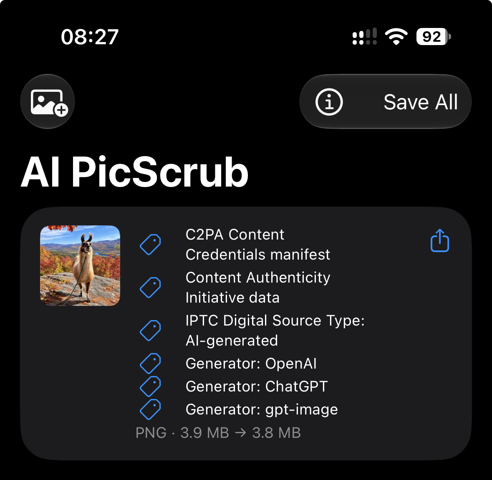

# Why Instagram says "AI info" on your photo

*Last updated: October 2026*

**Short answer:** Instagram and Facebook read hidden tags stored inside your photo file. When an AI tool edits a photo, even just to erase a single object, the tool usually writes a tag into the file saying so. Meta sees that tag and adds an "AI info" label to your post.

The label is about the file's metadata, not about how the photo looks. A real photo with one small AI edit can get the same label as a fully AI-generated image.

## Why did my real photo get labeled?

You most likely used an editing tool that adds AI tags to the files it saves. Common ones include:

- **Google Photos** Magic Editor, Magic Eraser and other AI edits on Pixel and Android phones
- **Samsung Galaxy AI** photo edits such as object erase and generative edit
- **Adobe Photoshop and Lightroom** Generative Fill, Generative Remove and Generative Expand
- **Apple** Image Playground and other Apple Intelligence image tools
- **ChatGPT, Gemini and other AI image tools** used to edit or touch up a photo

Some of these tools add the tag even when the change is tiny. Some go further: when you ask ChatGPT to remove a person from a photo and brighten the colors, it redraws the whole image and tags the result as fully AI-generated, the same tag it uses for an image made from scratch. Meta's rules don't distinguish between removing a power line and inventing a whole scene: if the tag is there, the label appears.

Meta has changed its labels several times. "Made with AI" was renamed "AI info" in 2024, and photos that were only edited with AI now usually show the label in the post's menu rather than on the photo itself. The cause is the same either way.

## What exactly is in the file?

There are two main kinds of AI tag:

- **C2PA Content Credentials.** A signed record, embedded in the file, of the tools used to create or edit the image. Adobe, OpenAI, Google, Samsung and others write these. They work in JPEG, PNG and HEIC files.
- **IPTC Digital Source Type.** A standard metadata field with values such as "trained algorithmic media" (fully AI-generated) or "composite with trained algorithmic media" (a photo edited with AI).

Files can also name the AI generator or editor in ordinary metadata fields, and images from Stable Diffusion often store the full prompt in a PNG text chunk.

None of this is visible when you look at the photo, but any app that reads metadata can see it.

## How to remove the "AI info" label

The label goes away when the tags are no longer in the file you upload. There are a few ways to do that.

### Take a screenshot

A screenshot creates a new file with no AI tags. But it also:

- reduces the resolution to your screen size
- re-compresses the image, which lowers quality
- loses the capture date, location and camera details
- loses HDR, so bright highlights look flatter

### Export without metadata

Some editors and apps can strip all metadata on export. This removes the AI tags, but also everything else: your photo's date, location and camera information. Many of these tools re-encode the image too, which costs some quality.

### Use AI PicScrub

[AI PicScrub](https://apps.apple.com/app/id6823995729) is an iPhone and iPad app that removes only the AI tags and leaves everything else alone.

1. Pick photos from your library. The app lists the AI metadata it finds in each one.
2. The app makes a copy of each photo with the AI tags removed.
3. Share the cleaned copies straight to Instagram, or save them to your library. Your originals are never changed.

The image itself is never re-encoded. The pixels, the file format, the capture date, location, camera details and HDR are all kept exactly as they were. Each copy is checked for leftover AI tags before it's offered, and if a tag can't be removed you'll see an error instead of a copy that's still tagged.

*A real photo edited in ChatGPT to remove a person and brighten the colors. AI PicScrub found six AI tags, including one marking it as fully AI-generated. The cleaned copy keeps the same PNG image and is slightly smaller because the tags are gone.*

## Will this always remove the label?

Not always. Removing metadata handles the most common cause, but:

- **Invisible watermarks** are hidden in the pixels themselves, not in the metadata. Google's SynthID and Meta's own AI images use them. No metadata tool, including AI PicScrub, removes them.
- **Meta may use other signals**, and it asks people to label AI content themselves. If you turned on the "AI label" toggle when posting, the label will appear regardless.

## Is it okay to remove the tag?

It depends on the photo and where you post it. Removing the tag doesn't change how an image was made.

- Only clean photos that you own or have permission to modify.
- Follow the rules of the platforms and places where you share, including any that require you to disclose AI-generated or AI-edited images.
- Don't use it to remove authorship or copyright information from other people's work, or to mislead anyone.

The most common use is for real photographs that were labeled because of a small cleanup edit, where the label gives viewers the wrong impression.

## Get AI PicScrub

AI PicScrub is available for iPhone and iPad on the [App Store](https://apps.apple.com/app/id6823995729). It supports JPEG, HEIC and PNG.

Questions? See the [AI PicScrub support page](support.md).
